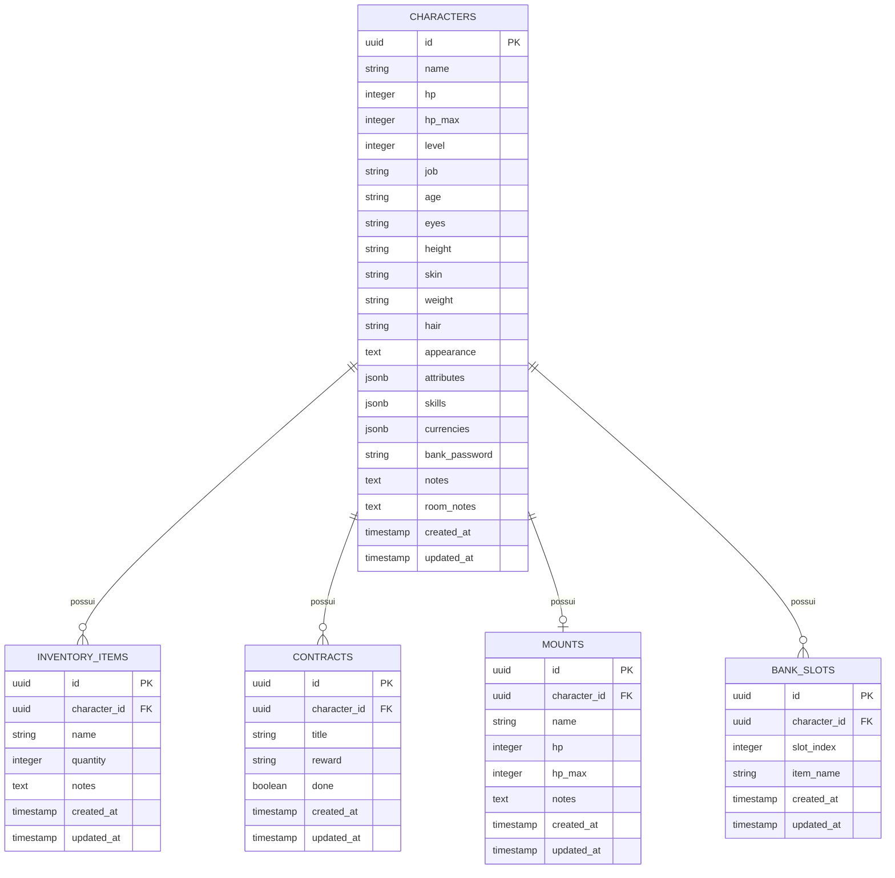

# Esquema de Banco de Dados: PostgreSQL & Sequelize

Este documento detalha o modelo relacional de banco de dados para a persistência da Ficha de RPG Web utilizando PostgreSQL e Sequelize ORM.

---

## 1. Diagrama Entidade-Relacionamento (ERD)



---

## 2. Descrição das Tabelas e Tipos

### 2.1. Tabela `characters`
Armazena a entidade central do jogador.

| Coluna | Tipo PostgreSQL | Sequelize DataType | Descrição |
| :--- | :--- | :--- | :--- |
| `id` | UUID (PK) | `DataTypes.UUID` | Identificador único com `defaultValue: DataTypes.UUIDV4`. |
| `name` | VARCHAR(120) | `DataTypes.STRING` | Nome do herói/personagem. |
| `hp` | INTEGER | `DataTypes.INTEGER` | Pontos de vida atuais. |
| `hp_max` | INTEGER | `DataTypes.INTEGER` | Pontos de vida máximos. |
| `level` | INTEGER | `DataTypes.INTEGER` | Nível do personagem (padrão 1). |
| `attributes` | JSONB | `DataTypes.JSONB` | `{ FOR: 14, DES: 16, CON: 14, SAB: 12, ESP: 14, CAR: 10, INT: 10 }`. |
| `skills` | JSONB | `DataTypes.JSONB` | Array com as 19 perícias (`name`, `attr`, `trained`, `bonus`). |
| `currencies` | JSONB | `DataTypes.JSONB` | Moedas `{ latina: 0, ouro: 66, prata: 70, cobre: 3 }`. |
| `bank_password`| VARCHAR(50) | `DataTypes.STRING` | Senha numérica/alfanumérica de acesso ao cofre. |
| `notes` | TEXT | `DataTypes.TEXT` | Anotações rápidas e lista de itens em bandoleiras. |
| `room_notes` | TEXT | `DataTypes.TEXT` | Anotações específicas de acomodação ou quarto. |

---

## 3. Configuração do Sequelize Singleton

Para evitar que o Next.js abra múltiplas conexões com o PostgreSQL durante o desenvolvimento com Hot Module Reloading (HMR):

```javascript
// src/db/sequelize.js
import { Sequelize } from "sequelize";
import pg from "pg";

let sequelize;

if (process.env.NODE_ENV === "production") {
  sequelize = new Sequelize(process.env.DATABASE_URL, {
    dialect: "postgres",
    dialectModule: pg,
    logging: false,
    dialectOptions: {
      ssl: process.env.DB_SSL === "true" ? { rejectUnauthorized: false } : false,
    },
  });
} else {
  if (!global._sequelizeInstance) {
    global._sequelizeInstance = new Sequelize(process.env.DATABASE_URL, {
      dialect: "postgres",
      dialectModule: pg,
      logging: false,
    });
  }
  sequelize = global._sequelizeInstance;
}

export default sequelize;
```
